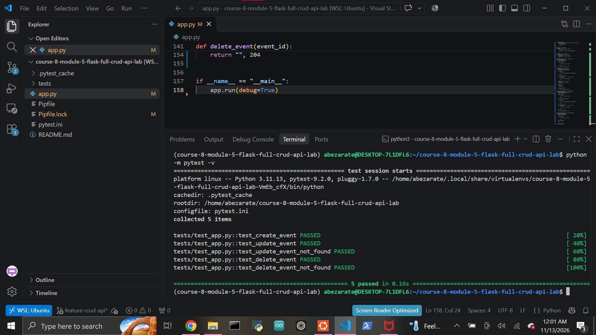

# Building Full CRUD RESTful APIs with Flask

A RESTful event-management API built with Python and Flask. The application demonstrates HTTP GET, POST, PATCH, and DELETE operations using an in-memory collection of `Event` objects.

## Features

The API supports:

- Viewing a welcome message
- Viewing all events
- Viewing an individual event by ID
- Creating new events
- Updating existing event titles
- Deleting events
- JSON request and response handling
- Input validation
- `404 Not Found` responses for missing resources
- RESTful HTTP status codes
- Reusable event lookup logic

## Technologies

- Python 3.11
- Flask
- Pytest
- Pipenv

## Project Structure

```text
course-8-module-5-flask-full-crud-api-lab/
├── app.py
├── Pipfile
├── Pipfile.lock
├── pytest.ini
├── README.md
├── images/
│   └── tests-passing.png
└── tests/
    ├── __init__.py
    └── test_app.py
```

## Setup

Clone the repository and enter the project directory:

```bash
git clone <your-repository-url>
cd course-8-module-5-flask-full-crud-api-lab
```

Install the project dependencies:

```bash
pipenv install
```

Enter the virtual environment:

```bash
pipenv shell
```

Confirm Python is available:

```bash
python --version
```

## Running the Application

Start the Flask development server:

```bash
python app.py
```

By default, Flask runs at:

```text
http://127.0.0.1:5000
```

## API Routes

### GET /

Returns a welcome message for the API.

Example:

```bash
curl http://127.0.0.1:5000/
```

### GET /events

Returns all events currently stored in memory.

Example:

```bash
curl http://127.0.0.1:5000/events
```

### GET /events/<id>

Returns a single event matching the supplied ID.

Example:

```bash
curl http://127.0.0.1:5000/events/1
```

If the event does not exist, the API returns a `404 Not Found` response.

### POST /events

Creates a new event.

Example request:

```bash
curl -X POST \
  -H "Content-Type: application/json" \
  -d '{"title":"Hackathon"}' \
  http://127.0.0.1:5000/events
```

Example response:

```json
{
  "id": 3,
  "title": "Hackathon"
}
```

A successful creation returns:

```text
201 Created
```

Requests without a valid `title` return:

```text
400 Bad Request
```

### PATCH /events/<id>

Updates the title of an existing event.

Example:

```bash
curl -X PATCH \
  -H "Content-Type: application/json" \
  -d '{"title":"Hackathon 2025"}' \
  http://127.0.0.1:5000/events/1
```

Example response:

```json
{
  "id": 1,
  "title": "Hackathon 2025"
}
```

A successful update returns `200 OK`.

If the requested event does not exist, the API returns `404 Not Found`.

### DELETE /events/<id>

Deletes an event.

Example:

```bash
curl -X DELETE \
  http://127.0.0.1:5000/events/2
```

A successful deletion returns:

```text
204 No Content
```

If the event does not exist, the API returns:

```text
404 Not Found
```

## Event Model

Events are represented by the `Event` class:

```python
class Event:
    def __init__(self, id, title):
        self.id = id
        self.title = title
```

Each event can be converted into a dictionary using `to_dict()` so Flask can return structured JSON data.

## In-Memory Storage

The project uses a Python list as a simulated database:

```python
events = [
    Event(1, "Tech Meetup"),
    Event(2, "Python Workshop"),
]
```

Changes made through POST, PATCH, and DELETE requests remain available while the Flask process is running.

Because the data is stored only in memory, restarting the application resets the collection to its original values.

## Validation and Error Handling

The application validates incoming JSON before modifying event data.

Requests with missing or blank event titles return:

```text
400 Bad Request
```

Requests for event IDs that do not exist return:

```text
404 Not Found
```

A reusable `find_event()` helper is used to avoid repeating event lookup logic across routes.

## Testing

Run the automated test suite with:

```bash
python -m pytest -v
```

Current result:

```text
5 passed
```

The tests verify:

- Creating an event with `POST /events`
- Updating an event with `PATCH /events/<id>`
- Returning `404` when updating a missing event
- Deleting an event with `DELETE /events/<id>`
- Returning `404` when deleting a missing event

## Test Evidence



## REST Status Codes

| Status | Meaning | Usage |
| --- | --- | --- |
| `200 OK` | Request succeeded | GET and PATCH |
| `201 Created` | Resource created | POST |
| `204 No Content` | Request succeeded with no response body | DELETE |
| `400 Bad Request` | Invalid request data | Missing or invalid title |
| `404 Not Found` | Resource does not exist | Missing event ID |

## Learning Outcomes

This lab demonstrates how to:

- Build RESTful routes with Flask
- Work with multiple HTTP methods
- Process JSON request bodies
- Return JSON with `jsonify()`
- Use dynamic route parameters
- Validate incoming API data
- Modify server-side application state
- Return meaningful HTTP status codes
- Reduce duplicate logic with helper functions
- Test API behavior using Pytest

## Author

Abraham Zarate